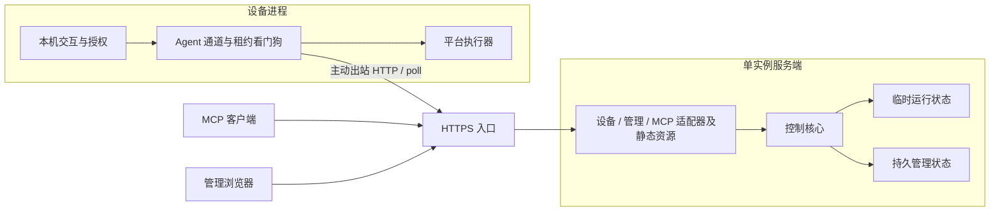

# Remota 整体架构设计

版本 Draft 2，日期 2026年11月8日。本文描述重写的目标架构；当前交付为设计、契约、消息 Schema 和验收规格，尚未实现产品。重写无需兼容原项目或旧草案。

整体采用单实例服务端、设备主动出站的 Agent、内嵌管理台和远程 HTTP MCP。服务端统一裁决远端身份与任务状态，Agent 独立裁决本机授权与进程生命周期。

## 文档边界

项目总入口与推荐阅读路径见[根 README](../README.md)。

本文负责组件划分、状态归属、依赖关系和部署边界。接口、字段、状态机、期限及错误规则以[契约入口](contracts/README.md)及其领域文档为准；页面行为见[管理台交互](product/console.md)。架构摘要不另行定义协议规则。

[关键消息 Schema](contracts/schemas/messages.schema.json)定义消息结构，[验收规格](contracts/acceptance/README.md)把正常流程和异常时序转成可观察结果。Schema 校验通过只证明结构合法，不能证明身份有效、许可仍有效或进程已退出。

## 组件与连接

箭头表示调用或状态访问。Agent 从请求响应中取得事件；管理台使用同源管理 API，AI 使用 MCP 工具。公网 HTTPS 由外部代理终止，服务端监听回环 HTTP，详细地址与信任规则见[通用 HTTP 规则](contracts/README.md#http-与-json)。

| 组件 | 职责与边界 |
|---|---|
| 服务端入口与协议适配器 | 校验 HTTP、消息结构、身份类型和资源绑定；将设备、管理员及 MCP 请求映射到控制核心；生成各自响应 |
| 控制核心 | 裁决会话、本机同意投影、凭据失效、诊断、任务受理、单次开始许可、停止与结算；生成管理快照和事件 |
| 管理状态存储 | 原子提交认证摘要、凭据元数据、签发关联和撤销记录；区分确认成功、确认未提交与结果未知，按契约进入核对或降级 |
| Agent | 完成本机确认、出站通道、事件去重、租约检查和任务领取；在本机权限收紧或连接异常时取消工作 |
| 平台执行器 | 管理独立命令进程及其回收边界，持续排空并限制输出，报告启动、未启动、退出或无法确认回收的事实 |
| 管理台 | 展示一致快照并提交管理操作；按当前浏览器身份隔离草稿、CSRF 和一次性秘密 |
| MCP 客户端 | 显式选择设备、使用稳定 request_id 提交意图、查询和取消任务；将受理与执行结果分别处理 |

服务端各职责位于同一进程，协议适配器通过控制核心访问运行状态。Agent 的本机授权、看门狗和执行器协作，但看门狗不能被长轮询或等待命令结束阻塞。

架构和契约不绑定具体编程语言。Agent、服务端及管理台可以分别选择实现语言、框架与运行时；并发模型和存储实现需要满足核心一致性、持久提交及期限语义。HTTP/JSON、MCP 和 Schema 是跨语言的连接边界。

语言无关不代表平台无关。shell 选择、进程组或 Windows Job、退出回收以及覆盖休眠的经过时间需要平台适配；`sh` 和 `powershell` 描述命令执行环境，不限定 Agent 或服务端的实现语言。

执行器的可观察行为集中在[平台执行器约定](contracts/tasks.md#平台执行器约定)，包括入口、编码、stdin、环境白名单和崩溃后的保证边界。Agent 不可用时，服务端仍以收到的执行证据裁决，不能由连接断开推断进程已退出。

## 控制核心的一致性边界

权限检查、状态前置条件与状态变更在同一核心一致性边界内完成。HTTP 处理、到期处理、管理撤权和设备回执都经该边界确定先后顺序；网络等待与进程等待在边界外进行，完成后重新检查当前状态。

这使撤权与申请开始可以得到确定的服务端顺序。Agent 在创建进程前仍需再次检查本机授权、修订、许可和期限；远端撤权已经发生而设备尚未获知时，停止依靠后续交付与有限租约收敛。架构不能把服务端撤权响应当作跨机器瞬时退出证明。

任务采用一个意图、一份不可变 TaskSpec、一个 StartGrant 和至多一次本机启动。事件确认、业务受理、开始许可、执行事实和最终结果各有独立含义。消息重复走原资源的重复处理规则；开始许可应答丢失后放弃启动，执行结果丢失后核对原任务。完整定义见[任务契约](contracts/tasks.md)。

重复许可始终沿用首次请求锚点与截止；核心已生效的停止原因优先于 Agent 上报结果，尚无停止原因时保留合法的本机取消或超时结果。详细裁决只在任务契约维护。

## 状态归属与保留

| 状态 | 所有者与保留方式 | 重启或结束时的处理 |
|---|---|---|
| 管理认证摘要、access/MCP 凭据摘要及元数据、签发关联、撤销记录 | 服务端持久管理存储；秘密原文只在首次交付时出现 | 正常重启保留最后成功提交的状态 |
| 设备会话、Agent 身份、同意投影、租约、事件、诊断与任务 | 当前服务进程的临时状态 | 重启清空；会话结束立即去除命令、输出、备注和缓存设备信息，仅有界保留清理元数据 |
| 管理员登录、CSRF、MCP 传输会话与客户端记录 | 当前服务进程内存 | 重启失效；MCP 重新初始化产生新上下文 |
| 本机同意、权限修订、请求代际、已领取任务及放弃启动记录 | 当前 Agent 运行上下文 | 不跨进程恢复执行权；结束的本机上下文不可复活 |
| 命令进程、有限输出和退出观察 | Agent 平台执行器 | 取消时请求停止并确认回收；无法确认时如实报告未知 |
| 管理台快照、草稿与一次性秘密 | 当前浏览器登录的页面内存 | 退出或身份失效时清除；语言偏好按页面规范处理 |

Session.cleanup 从已有许可任务的执行证据派生；停止确认使用任务自身的期限。状态与清理算法分别见[设备会话](contracts/agent.md#设备会话)和[取消与竞态](contracts/tasks.md#取消与竞态)。结束保留期允许补充无输出的退出证据，不恢复授权或原命令结果。

## 授权与执行主流程

1. Agent 使用 access 凭据申请临时会话，在本机说明用途并取得 readonly 或经过二次确认的 full；服务端确认和首个有效租约建立后才开放相应能力。
2. MCP 客户端完成初始化，发现并显式选择设备。固定诊断走 ping/info；命令走异步任务。
3. 控制核心受理命令并保存完整意图，Agent 从 poll 得到 offer、去重后申请开始许可。核心重新检查远端权限，Agent 在启动前重新检查本机条件。
4. 执行器创建独立进程，报告事实和有限输出；控制核心按已接受的停止原因与结果结算，MCP 通过原任务查询结果。
5. 结束、降权、失联或到期触发本机停止及远端状态收紧。退出确认与业务结算分开处理，未知结果保留为未知。

消息级时序与状态机只在[任务执行顺序](contracts/tasks.md#完整执行顺序)、[Agent 状态与异常](contracts/agent.md#agent-本机状态与异常)、[MCP 生命周期](contracts/mcp.md#初始化与生命周期)维护。

本机同意决定可做什么；租约决定当前是否仍可工作；开始许可决定指定任务是否可启动；固定任务截止限制该次执行。续租允许长命令继续运行，但不延长任务固定截止。预算绑定请求的本机发送时刻，详见[时间与期限](contracts/README.md#时间与期限)。

## 部署与故障边界

一个部署由一个服务端进程、独占的管理状态目录、内嵌静态资源及可选的公网 HTTPS 代理组成。管理员登录、设备接入与 MCP 保持不同身份命名空间；代理配置不能替代服务端 Host、Origin、CSRF 和 Bearer 检查。

首次初始化一次性交接管理口令与初始接入凭据，后续修改经持久提交后才报告成功。管理写入失败时，核心收紧内存权限并进入 degraded，保留停止、清理和必要的只读观察入口。状态损坏、版本未知或初始化后状态丢失时拒绝启动。具体行为见[重启与存储故障](contracts/README.md#重启与存储故障)。

首次初始化、普通启动和故障恢复是独立的本机管理操作。普通启动不会把空状态识别为首次安装；恢复需核实持久状态再启动。具体前置条件见[初始化与恢复](contracts/README.md#初始化与恢复)。

每次服务启动生成新的 epoch。正常重启保留管理凭据，清除所有临时执行上下文；Agent 停止旧工作，MCP 只能显式初始化新客户端，设备再次接入需要重新取得本机同意。任何恢复路径都以当前有效状态为依据。

## 实施顺序与验收入口

技术选型、目标目录和分步通过条件见[第二阶段实施规划](implementation.md)。该规划是推荐实现，本文的组件职责与契约不依赖所选语言或框架。

行为由[契约](contracts/README.md)、[Schema](contracts/schemas/messages.schema.json)、[合成正反样例](contracts/acceptance/messages.json)及[验收规格](contracts/acceptance/README.md)共同表达。六类关键异常为重复提交、开始许可丢失、结果丢失、撤权竞态、租约到期和服务端重启，其他边界在同一验收规格补充。

先运行[最小契约校验](contracts/acceptance/README.md#最小校验入口)检查规范与样例一致，再实现控制核心的状态与权限裁决，随后贯通设备执行、MCP 和管理台。每个外部入口复用同一核心行为。时序、进程回收和故障注入仍需真实实现验证；契约校验工具的语言不限定产品实现语言。
