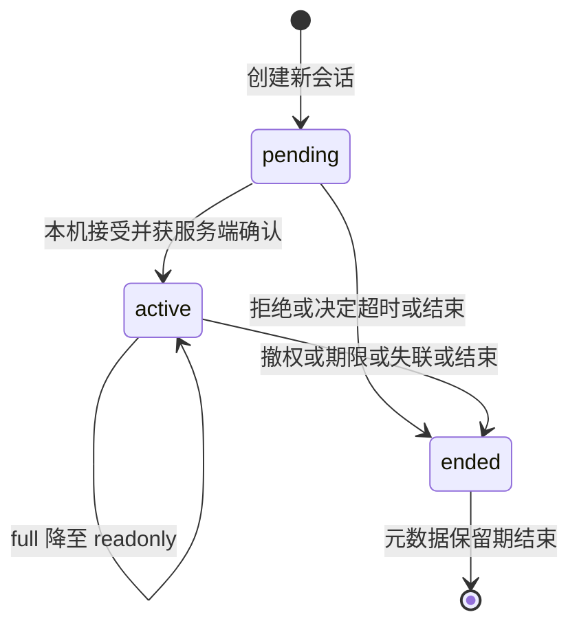

# Remota 设备通道契约

设备通道只服务一个 Agent 主动建立的临时会话。设备不监听控制端口，也不提供浏览器授权接口。所有路径以 /api/v1/agent 为前缀；除注册使用 access Bearer 外，均使用该会话的 Agent Bearer。通用限制见 [通用规则](README.md)，任务类型见 [任务语义](tasks.md)。

本通道 HTTP 绑定由[OpenAPI YAML](../../api/openapi.yaml)维护，关键消息的结构见[Schema](schemas/messages.schema.json)，跨消息授权、期限及故障时序见[验收规格](acceptance/README.md)。下文字段表用于查阅，状态和处理语义仍在本页定义。

## 设备会话

Session 的公共字段如下。管理员额外字段由管理员通道定义。

| 字段 | 类型与条件 |
|---|---|
| id | ses ID |
| state | pending、active、ended |
| operator_display_name | 部署配置中的展示名称，最多 80 UTF-8 字节，不作为身份认证 |
| purpose | 固定 temporary_remote_assistance |
| created_at、expires_at、decision_deadline | 服务端时间，全部必填 |
| consent? | 同意后出现，{mode, revision, decided_at}；mode 为 readonly 或 full，revision 为正整数 |
| granted_capabilities | 派生 string 数组；pending/ended 为空，active readonly 为 ping、info，active full 再增加 exec |
| connection | {activity, last_seen_at?}；activity 为 never_seen、recent、stale |
| ended_at、end_reason、cleanup | 仅 ended 必填 |

connection 仅根据最近成功的 active poll 观察。尚无 poll 为 never_seen，最近成功 poll 距当前不超过 15 秒为 recent，此后 stale；不代表授权有效、设备仍联网或进程已经退出。

end_reason 为 local_rejected、decision_timeout、local_end、stdin_eof、signal、admin_end、access_invalid、session_expired、lease_expired、execution_unknown、protocol_error、server_shutdown、server_degraded 之一。首次结束原因固定，后续清理不覆盖。

cleanup 是只读枚举，由本会话已发许可任务的证据派生，不保存独立状态或截止：

- 没有签发过许可：not_needed。
- 全部已有退出或明确未启动证据：confirmed。
- 存在 execution.state=unknown：unknown。
- 其余仍等待任务停止确认：pending。

任务的停止确认等待届满会使 cleanup 派生为 unknown；没有额外清理观察窗口。结束保留期内补到退出证据后可派生为 confirmed，不恢复授权。



pending 不允许读取系统信息或执行命令。readonly 是有效接入模式，允许固定 ping/info；full 还允许异步命令。两者都以本机选择和有效租约为前提。首次 consent.revision=1，成功降权后加 1。

## 端点目录

下表从[OpenAPI](../../api/openapi.yaml)生成，均省略前缀 /api/v1/agent。Schema 名称对应[消息目录](schemas/messages.schema.json)中的同名 $defs；Empty 表示 JSON 空对象，无请求体不等于 Empty。注册使用 access Bearer，其余操作使用绑定会话的 Agent Bearer。GET 不续租；TaskResponse 中的 task 为 TaskMeta。错误状态见 OpenAPI，特定业务约束见各段。

<!-- BEGIN GENERATED OPENAPI: agent -->
<!-- Generated from api/openapi.yaml; use --refresh-openapi. -->
| 方法与路径 | 请求 Schema | 成功响应（状态、Schema） |
|---|---|---|
| POST /sessions | Empty | 201 Registration |
| GET /sessions/{sid} | 无请求体 | 200 SessionResponse |
| PUT /sessions/{sid}/decision | DecisionInput | 200 DecisionResponse |
| PUT /sessions/{sid}/consent | ConsentReduction | 200 SessionResponse |
| POST /sessions/{sid}/poll | PollInput | 200 PollResult |
| POST /sessions/{sid}/close | CloseInput | 200 SessionResponse |
| POST /sessions/{sid}/calls/{call_id}/result | CallResultInput | 204，无 JSON 正文 |
| POST /sessions/{sid}/tasks/{tid}/start | StartInput | 200 StartResponse |
| POST /sessions/{sid}/tasks/{tid}/receipts | ReceiptInput | 200 TaskResponse |
| POST /sessions/{sid}/tasks/{tid}/result | ResultInput | 200 TaskResponse |
<!-- END GENERATED OPENAPI: agent -->

不存在替设备提交命令的设备端点，不存在全局“当前设备”。

## 注册和本机决定

Registration 为 {session, agent_token, session_remaining_ms, decision_remaining_ms}。remaining 值为正整数毫秒；X-Remota-Epoch 必须保存到本次 Agent 运行上下文。Session 初始为 pending，不包含主机名、OS、用户名或其他设备探测值。

实际期限可被临近到期的 access 截短，不增加父凭据最短剩余量门禁；TTL、决定和首次 poll 截止统一按[时间与期限](README.md#时间与期限)计算。

```json
{
  "session": {
    "id": "ses_11111111111111111111111111111111",
    "state": "pending",
    "operator_display_name": "Remota Support",
    "purpose": "temporary_remote_assistance",
    "created_at": "2026-11-08T04:00:00.000Z",
    "expires_at": "2026-11-08T05:00:00.000Z",
    "decision_deadline": "2026-11-08T04:02:00.000Z",
    "granted_capabilities": [],
    "connection": {"activity": "never_seen"}
  },
  "agent_token": "rm_agent_AAAAAAAAAAAAAAAAAAAAAAAAAAAAAAAAAAAAAAAAAAA",
  "session_remaining_ms": 3600000,
  "decision_remaining_ms": 120000
}
```

真实秘密仅交付给当前设备进程，不写入文件、终端日志或网页。注册应答丢失不自动重试或按主机名查找旧会话；提示可能留下 pending，可等待其决定期限届满或由管理员清理。

设备在本机展示服务地址、operator、用途、绝对截止以及权限说明，默认选 readonly。full 必须二次确认，并明确本次后续命令不逐条询问、以当前用户执行、可随时降权或结束。EOF、拒绝、Ctrl+C 均不批准 full。非交互输入、CLI flags 和保存配置不能授予 full。

DecisionInput 为以下互斥对象：

- 接受：{decision: "accept", mode: "readonly" | "full"}。
- 拒绝：{decision: "reject"}，不得附 mode。

只有 pending 可作首次决定，服务端保存初始选择。active 时重复相同初始选择返回当前 Session，其他决定为 INVALID_STATE；重复原 full 决定不会把已降权的 readonly 恢复为 full。ended 返回 SESSION_ENDED，核对结束结果使用 GET。

activation_remaining_ms 为首次有效 poll 窗口剩余量，不因重试重置；默认窗口见 [运行默认值](README.md#运行默认值)。Agent 核对 Session ID、mode、revision 与截止，确认前或首个有效 lease 前不读取系统信息、不执行命令。应答丢失只重发相同决定或 GET 核对；窗口到期则结束。拒绝立即 ended。

## 降权和结束

ConsentReduction 为 {expected_revision, mode: "readonly"}。active/full 时 expected_revision 必须匹配，成功后 revision 加 1，否则 REVISION_CONFLICT 并返回 current_revision。active 已 readonly 时重复收紧返回当前 Session，不再改修订；请求 full 始终为 LOCAL_RECONSENT_REQUIRED。

Agent 先原子收紧本机状态并取消任务，再发送降权。可重发相同正文；等待、网络失败或修订冲突时均阻止执行，不以远端 full 覆盖本机状态。无法在有效租约内同步则结束。

CloseInput 为 {reason}，仅允许 local_end、stdin_eof、signal、lease_expired、protocol_error。Agent 先结束本机授权和取消工作，再尽力提交。重复关闭返回现有 Session，首次结束原因固定，不延长保留期。

服务端任何结束操作都立即禁止新诊断、命令受理、开始许可和续租，取消未开始任务，对可能启动的任务请求停止。立即删除命令正文、输出、缓存主机信息和备注；只保留有界清理元数据。结束会话并不等于所有进程已经退出。

## poll 与租约

PollInput 为 {consent_revision, ack_event_ids}。revision 为 0 或正整数；active 必须与服务端当前修订一致，ended 仅用于关联旧上下文。ack_event_ids 为不重复的 evt ID 数组，可为空；数组长度与批次大小使用通用 [poll 上限](README.md#容量与数据限制)。

同会话第二个在途 poll 为 ALREADY_POLLING，不续租；Agent 等待原请求结束且受原租约限制。pending 为 INVALID_STATE。active 在本次长轮询等待结束时返回批次，事件可为空；等待和 HTTP 超时建议见 [运行默认值](README.md#运行默认值)。实际返回前重查 access、会话、租约、修订和管理健康。

PollResult 为 {session, session_remaining_ms, lease?, events}。ended 时 remaining 为 0，省略 lease，只返回清理事件。active 成功响应必须有 Lease：

| Lease 字段 | 约束 |
|---|---|
| seq | 本会话严格递增的正整数 |
| consent_revision | 与 Session 和请求一致 |
| issued_at、expires_at | 服务端时间，expires_at 不晚于 Session 截止 |
| valid_for_ms | 正整数；不超过通用设备授权租约及该响应时会话剩余量 |

```json
{
  "consent_revision": 1,
  "ack_event_ids": ["evt_99999999999999999999999999999999"]
}
```

Agent 按通用 [时间算法](README.md#时间与期限)将 Lease 绑定到此 poll 的发送时刻和本机修订，仅在响应完整、HTTP 200、epoch 一致、请求未取消、seq 更新且所有期限有效时接受；缓存响应不能作为心跳。

空事件批次也是有效心跳，完整响应示例如下：

```json
{
  "session": {
    "id": "ses_11111111111111111111111111111111",
    "state": "active",
    "operator_display_name": "Remota Support",
    "purpose": "temporary_remote_assistance",
    "created_at": "2026-11-08T04:00:00.000Z",
    "expires_at": "2026-11-08T05:00:00.000Z",
    "decision_deadline": "2026-11-08T04:02:00.000Z",
    "consent": {
      "mode": "full",
      "revision": 1,
      "decided_at": "2026-11-08T04:00:01.000Z"
    },
    "granted_capabilities": ["ping", "info", "exec"],
    "connection": {
      "activity": "recent",
      "last_seen_at": "2026-11-08T04:00:10.000Z"
    }
  },
  "session_remaining_ms": 3590000,
  "lease": {
    "seq": 2,
    "consent_revision": 1,
    "issued_at": "2026-11-08T04:00:10.000Z",
    "expires_at": "2026-11-08T04:00:40.000Z",
    "valid_for_ms": 30000
  },
  "events": []
}
```

若已有服务端租约到期，后续 poll 不能续活旧会话。首个 poll 受 activation 窗口约束；以后只有有效 poll 续租。GET、诊断回报、任务回报和 start 均不续租。

poll 超时、5xx 等失败先取消工作并暂停新执行。可在原租约内退避重连并遵守 Retry-After，退避策略由 Agent 选择，独立看门狗持续生效。成功响应只恢复原会话传输，不重启任务；租约届满或有效性不可证明时结束，禁止自动注册。410 立即停止旧工作；身份和协议错误按 [统一异常处理](#agent-本机状态与异常)执行。

## 事件格式与确认

Event 的必填字段为 id、type、session_id、created_at、payload。call.request 和 task.offer 必须另有 deadline，分别等于诊断截止和任务 offer_deadline；超时不再执行。task.cancel 与 session.end 不含事件 deadline，停止指令不能因观察窗口过去而被忽略。事件不可变，重复交付保持 id 和 payload。顺序是 session.end、task.cancel、call.request、task.offer；同类按创建时间和 ID 排序。

| type | payload | 语义确认 |
|---|---|---|
| session.end | {reason, ended_at} | 传输确认后可停止重发；不构成进程退出证明 |
| task.cancel | {task_id, reason, confirmation_deadline} | 在退出或未启动证据前保持可重发；确认截止不取消停止义务 |
| call.request | {call_id, method, consent_revision}；method 为 ping 或 info | CallResult 或调用截止 |
| task.offer | {task: TaskDetail}；仅 active/full 可交付 | start、未启动回执或任务结算 |

ack_event_ids 只确认事件进入本机去重与处理队列。普通事件可停止重发；task.cancel 直到退出或未启动证据前始终可重发。已清理或未知的合法 ack ID 忽略，非法格式使整个请求 INVALID_ARGUMENT 且不续租。

取消与结束指令由核心状态派生，不依赖普通队列容量。重复事件、ack 或重连不能清除本机 task_id 去重记录；未知 type、资源不匹配或非法权限值均结束会话。

```json
{
  "id": "evt_99999999999999999999999999999999",
  "type": "task.cancel",
  "session_id": "ses_11111111111111111111111111111111",
  "created_at": "2026-11-08T04:00:10.000Z",
  "payload": {
    "task_id": "tsk_22222222222222222222222222222222",
    "reason": "operator_cancel",
    "confirmation_deadline": "2026-11-08T04:00:15.000Z"
  }
}
```

## 固定诊断

call.request.deadline 为创建时刻加固定诊断等待，且不晚于会话截止，默认值见 [运行默认值](README.md#运行默认值)。Agent 只执行固定 ping/info，再核对 active、本机模式、修订、租约与 deadline。

CallResultInput 为 {consent_revision, result} 或 {consent_revision, error}，二者互斥，call_id 从路径取得。结果类型由原 method 决定：

- ping：{pong: true, agent_time}，agent_time 为设备自报时间，仅供展示。
- info：{agent_version, os, arch, hostname, supported_shells}。agent_version 为 1 至 80 字节；os 为 windows、linux、darwin；arch 为 amd64 或 arm64；hostname 最多 255 字节；supported_shells 为不重复的 sh/powershell 数组。
- error：{code}，code 为 LOCAL_PERMISSION_DENIED、UNSUPPORTED_DIAGNOSTIC、DEADLINE_EXCEEDED 或 INTERNAL_ERROR。

同 call_id 的相同结果在原 deadline 前可重复确认，异值为 RESULT_CONFLICT；Agent 缓存首次结果，不重复探测。确认记录计入诊断配额，deadline 后清除，再回报为 CALL_EXPIRED。向 MCP 返回前重查调用身份和本机同意；有效 info 可暂存展示。

## 任务请求与回执

StartInput 为 {consent_revision}，成功返回 {task: TaskDetail, grant: StartGrant}。每个 task_id 只有一个 grant，检查与丢响应行为见 [开始许可](tasks.md#开始许可)。

ReceiptInput 必填 kind，其余字段按下表限定，禁止输出：

| kind | 其他字段 | 含义 |
|---|---|---|
| started | grant_id 必填 | 命令进程已创建 |
| not_started | reason 必填，grant_id 已核验时携带 | 明确未创建命令进程 |
| exited | grant_id 必填，exit_code 可选 | 无输出的退出及回收证据 |
| stop_unconfirmed | grant_id 必填，error_code=PROCESS_STOP_UNCONFIRMED | 执行器不能确认回收 |

回执按 (task_id, kind) 处理重复事实，相同正文返回当前 TaskMeta，不同正文为 RESULT_CONFLICT。事实兼容性和结算由任务文档定义。

not_started.reason 仅允许 LOCAL_PERMISSION_DENIED、UNSUPPORTED_SHELL、SPAWN_FAILED、GRANT_UNAVAILABLE、GRANT_MISMATCH、GRANT_EXPIRED、CANCELLED_BEFORE_SPAWN、SESSION_ENDED、TRANSPORT_LOST。回执的事实兼容性与结算映射统一见 [任务状态机](tasks.md#状态机)。

完整结果使用 [ResultInput](tasks.md#结果与输出)，其中定义结果接收条件、权限收紧后的处理与回报重试。无法确认进程回收时发送 stop_unconfirmed，不接收下一条命令，具体转换见 [取消与竞态](tasks.md#取消与竞态)。

## 结束后的有界清理

ended 后的 [结束保留期](README.md#运行默认值)内，原 Agent credential 只可 GET Session、poll 清理指令、close 和发送任务回执。只核验原 Agent 身份、资源绑定、期限及清理类型，不要求已失效的父 access 再次有效。

这些请求不续租、不交付 task.offer/call.request、不创建任务、不读取输出。迟到证据的处理按 [任务结算规则](tasks.md#取消与竞态)；完整 result、decision、consent 和 start 在 ended 均为 410 SESSION_ENDED。保留期结束后删除 Agent 身份与元数据：原 Agent 已无法认证，返回 401 UNAUTHENTICATED；有效 MCP 或管理员身份查询已清除资源返回 404。不能为了返回资源错误而跳过鉴权或泄漏资源存在性。

## Agent 本机状态与异常

Agent 本机依次为 awaiting_decision、confirming、active、reconnecting、ended，mode 为独立的 readonly/full 值。confirming 尚无执行权；reconnecting 暂停执行并取消当前工作；恢复只能回到尚未到期、未终止的原会话。ended 不存在返回 active 的边。

任一设备请求出现 401、403、epoch 改变、未知事件、数据或协议结构不一致时，立即结束旧本机授权。操作特有的异常与核对方式分别定义在上文注册、决定、降权、poll 和任务章节，本节不另设恢复策略。
