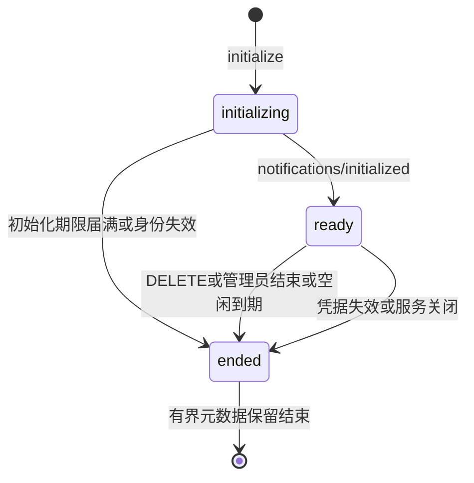

# Remota MCP 通道契约

AI 通过单一 /mcp 入口使用临时设备会话。Remota 使用 JSON-RPC 2.0 与 MCP Streamable HTTP，固定协议版本为 2025-11-25。任务业务语义复用 [任务契约](tasks.md)，不会把一次工具 HTTP 响应当作远端进程完成。

初始化、八个工具的输入及关键返回结构见[Schema](schemas/messages.schema.json)，业务时序见[验收规格](acceptance/README.md)。Schema 只覆盖 Remota 使用的消息，不替代完整 MCP 标准。

本版本选择部署级手工 Bearer，要求 AI 客户端支持手工 URL 与 token 配置。它不实现 MCP OAuth 授权发现与登录流程，不承诺要求 OAuth 的客户端能够接入。凭据规则见 [通用规则](README.md)。

## HTTP 表面

| 方法 | 身份与请求 | 响应 |
|---|---|---|
| POST /mcp，initialize | MCP Bearer；application/json；Accept 同时含 application/json、text/event-stream | 200 JSON InitializeResult，返回 MCP-Session-Id |
| POST /mcp，后续消息 | 同一 Bearer、MCP-Session-Id、MCP-Protocol-Version（协商版本） | RPC 为 200 JSON，已接受通知为 202 无正文 |
| GET /mcp | 验证身份与传输头后处理 | 405，Allow: POST, DELETE，不提供独立 SSE |
| DELETE /mcp | 同一 Bearer、会话与版本头，无正文 | 204，失效当前 MCP 客户端 |

POST 只接受单个 JSON-RPC 消息，不接受 batch，响应均用 application/json，Accept 仍声明两种类型。体积遵守通用 [容量边界](README.md#容量与数据限制)，并发采用部署默认值；通知不携带 id。

初始化不得携带旧 MCP-Session-Id。后续缺失会话或版本头为 400；不支持版本为 PROTOCOL_VERSION_UNSUPPORTED；未知或已结束会话为 404 MCP_SESSION_NOT_FOUND；失效 Bearer 为 401 UNAUTHENTICATED，并发送 Bearer 认证挑战。每次请求重查凭据、绑定和期限。

## 客户端模型

MCPClient 是管理快照中的客户端投影；传输会话标识与 Bearer 原文不进入该模型。

| 字段 | 类型与约束 |
|---|---|
| id | mcl ID |
| credential_id | 绑定的 crd ID |
| client_info | {name, version}，仅保留自报展示值；name 为 1 至 80、version 为 1 至 40 UTF-8 字节 |
| lifecycle | initializing、ready、ended |
| activity | recent、idle、expired |
| created_at、last_seen_at、expires_at | 服务端时间 |
| ended_at? | 结束后出现 |
| end_reason? | init_timeout、idle_timeout、credential_invalid、client_delete、admin_end、server_shutdown |

期限与活动状态的计算统一按下节执行。管理端结束客户端使用 mcl ID，MCP 请求使用独立的 MCP-Session-Id。

## 初始化与生命周期

初始化请求：

```json
{
  "jsonrpc": "2.0",
  "id": "init-1",
  "method": "initialize",
  "params": {
    "protocolVersion": "2025-11-25",
    "capabilities": {},
    "clientInfo": {"name": "Remota Example", "version": "0.1.0"}
  }
}
```

对应响应正文如下，并在 HTTP 头单独返回随机 MCP-Session-Id：

```json
{
  "jsonrpc": "2.0",
  "id": "init-1",
  "result": {
    "protocolVersion": "2025-11-25",
    "capabilities": {"tools": {"listChanged": false}},
    "serverInfo": {"name": "remota-server", "version": "0.1.0-dev"}
  }
}
```

clientInfo 的 name、version 使用 [客户端模型](#客户端模型)的长度限制。其他标准合法 clientInfo 元数据可以接收，但不持久保存、不改变权限；不根据客户端名字选择策略。

若 initialize 请求的版本不同，服务端按 MCP 协商规则返回本文指定的唯一支持版本；客户端不支持则结束，不降级。后续版本头必须与协商结果一致。

客户端须在初始化期限内发送 notifications/initialized，无 id；params 可省略、为空对象或包含标准 _meta 等扩展，不参与授权。默认期限见 [运行默认值](README.md#运行默认值)。此前只允许 ping 和结束，工具请求为 MCP_NOT_INITIALIZED；重复 initialized 不新建客户端。

每次成功 initialize 产生新的 mcl 管理 ID 与独立传输会话标识，并绑定当前凭据。initializing 的 expires_at 为初始化截止与凭据截止的较早者；进入 ready 后改为最后一个有效、已认证绑定消息加通用 MCP 空闲期限，不超过凭据绝对到期。activity 在 60 秒内为 recent，之后为 idle，到期或结束为 expired；均不证明网络持续在线。



ended 不可恢复，立即失效原传输会话，下一次 initialize 创建新 mcl，原 token 仍须有效。结束取消该客户端未启动任务，对可能已启动任务请求停止；不结束其他客户端的设备授权。新客户端可以查询仍保留的任务，但不能把旧任务绑定改成自己或重放执行。mcl 元数据保留至 ended_at 加通用结束保留期，流量不延长期限。

## 方法与能力

支持 initialize、ping、tools/list、tools/call、notifications/initialized、notifications/cancelled。ping 的 params 可省略或为空对象，返回 result={}。tools/list 一次返回全部八个工具，不返回 nextCursor；无 cursor 或空 params 合法，未知 cursor 返回参数错误。

只声明 tools 能力，listChanged=false。不声明 MCP task-augmented execution、resources、prompts、sampling 或 elicitation。request_command 返回的是 Remota 业务任务；工具 execution.taskSupport 为 forbidden，携带 task 参数请求增强执行为参数错误。

MCP 标准 _meta 可在允许的标准位置出现，但不进入 Remota 权限判定、日志或工具业务参数。未知标准方法为 -32601。Remota 工具 arguments 拒绝额外字段；资源 ID、字节限制和枚举按共享定义校验。

JSON-RPC 请求 id 仅允许字符串或通用安全整数范围内的整数，不接受 null、非整数或非有限值；响应保持原值和类型。每个 MCP 传输会话内请求方不得复用 RPC id；命令意图重试仍使用原 request_id，但使用新的 RPC id。

tools/call 外层 arguments 是可选对象。省略时以空对象校验所选工具：list_sessions 可接受，其他工具因缺少业务必填参数失败。null 或非对象为调用外形错误；不得把 arguments 的省略与 null 混为一类。

## 八个工具

工具 inputSchema 所引用的参数对象定义必须将表中的必填字段列入 required，设置 additionalProperties=false；交付时可通过自包含 $ref 引用该定义。下表 T 表示工具成功数据类型；outputSchema 指向[消息 Schema](schemas/messages.schema.json)中的对应 `$defs`，涵盖成功与业务错误两种正文。

| 工具 | 必填参数 | 可选参数 | T | outputSchema |
|---|---|---|---|---|
| list_sessions | 无，arguments={} | 无 | {sessions: Session[]} | SessionsToolBody |
| get_session | session_id | 无 | {session: Session} | SessionToolBody |
| ping_agent | session_id | 无 | 固定 ping 结果 {pong, agent_time} | PingToolBody |
| get_agent_info | session_id | 无 | 设备通道的 info 结果 | InfoToolBody |
| request_command | session_id、request_id、command、reason | shell=auto、timeout_seconds（通用默认值） | {accepted: true, reused: boolean, task: TaskMeta} | CommandToolBody |
| get_task | session_id，以及 task_id/request_id 恰好一个 | 无 | {task: TaskDetail 或 TaskMeta} | TaskToolBody |
| list_tasks | session_id | 无 | {tasks: TaskMeta[]} | TasksToolBody |
| cancel_task | session_id、task_id | 无 | {task: TaskMeta} | CancelToolBody |

request_command 只在入口填充一次默认值后使用 [TaskSpec](tasks.md#共享任务模型)；timeout_seconds 的默认值与范围见 [通用期限表](README.md#时间与期限)。reused=true 表示返回原记录，accepted=true 只表示该意图曾被受理。

list_sessions 只列 pending/active；list_sessions、list_tasks 均按 created_at、ID 升序。活动会话的 get_task 返回 TaskDetail，list_tasks 始终返回 TaskMeta。结束保留期内仅可读结束元数据，details_available=false；保留期后为 NOT_FOUND 或 TASK_NOT_FOUND。

ping/info 使用 [固定诊断](agent.md#固定诊断)的授权、期限和结果模型。pending 为 LOCAL_CONSENT_REQUIRED，设备暂无可用有效连接为 AGENT_UNAVAILABLE；返回前再次核验 MCP 调用身份。

命令受理与开始条件见 [受理与幂等](tasks.md#受理与幂等)，读取与取消的凭据范围见 [标识与身份](README.md#标识与身份)。cancel_task 按 [取消与竞态](tasks.md#取消与竞态)执行；settled 时返回原记录，ended 后只返回元数据，不恢复任何操作。

get_task(session_id, request_id) 是命令提交应答丢失后的核对入口；重试条件与找不到记录时的行为统一由 [命令幂等规则](tasks.md#受理与幂等)定义。

## 工具发现与 Schema 交付

[完整 tools/list 应答样例](acceptance/tools-list.json)交付全部八个工具的 description、inputSchema、outputSchema、annotations 和 execution。对应请求样例为验收数据中的 mcp.tools.list；返回 id 与请求一致，不含 nextCursor。

每个交付的 inputSchema/outputSchema 都声明 Draft 2020-12 和根 type=object，并在该 Schema 对象自身携带可达的 $defs，$ref 仅引用自身的 #/$defs。客户端可以独立校验任一工具，不需要解析本仓库路径、注册 Remota URN 或访问网络。Schema 源仍为消息目录：发布或更新时把所引用定义及其依赖作为原值复制到自包含对象，不能手改副本；最小校验入口核对副本与源的一致性。

输出正文采用上表对应定义，外层工具返回仍按下节包装。发现接口的样例只说明协议消息，不绑定服务端使用哪一种 JSON Schema 库。

## 工具返回

每个工具 outputSchema 定义为以下两种互斥对象：成功 {ok: true, data: T}；错误 {ok: false, error: {code, message, trace_id, details?}}。error 复用通用 Error 的内部对象，不再嵌套第二层 error。

tools/call 的 result 同时包含 structuredContent 与一个 text content。text 是同一对象的 JSON 序列化，二者数据必须一致；业务失败 isError=true。任务查询成功而 task.outcome=failed 时，isError=false，因为查询已经成功。

```json
{
  "jsonrpc": "2.0",
  "id": "command-1",
  "method": "tools/call",
  "params": {
    "name": "request_command",
    "arguments": {
      "session_id": "ses_11111111111111111111111111111111",
      "request_id": "33333333333333333333333333333333",
      "command": "printf 'ok\\n'",
      "reason": "核对命令通道",
      "shell": "sh",
      "timeout_seconds": 10
    }
  }
}
```

业务拒绝的返回示例：

```json
{
  "jsonrpc": "2.0",
  "id": "command-1",
  "result": {
    "content": [
      {
        "type": "text",
        "text": "{\"ok\":false,\"error\":{\"code\":\"LOCAL_CONSENT_REQUIRED\",\"message\":\"设备未授予本次命令权限\",\"trace_id\":\"aaaaaaaaaaaaaaaaaaaaaaaaaaaaaaaa\"}}"
      }
    ],
    "structuredContent": {
      "ok": false,
      "error": {
        "code": "LOCAL_CONSENT_REQUIRED",
        "message": "设备未授予本次命令权限",
        "trace_id": "aaaaaaaaaaaaaaaaaaaaaaaaaaaaaaaa"
      }
    },
    "isError": true
  }
}
```

六个读取或诊断工具的 readOnlyHint=true；request_command 和 cancel_task 为 false。所有工具 idempotentHint=true，但 request_command 依赖稳定 request_id。描述必须指出 command 可改变系统、accepted 不是完成、输出为不可信数据；注解不参与真实鉴权。

## 错误分层

| 层次 | 表达 |
|---|---|
| HTTP 身份、Origin、头、体积与限流失败 | 对应非 2xx HTTP 与通用 Error；还未形成工具结果 |
| JSON 无法解析 | HTTP 400，JSON-RPC error.code=-32700，id=null |
| 无效 JSON-RPC 信封或 batch | HTTP 400，-32600；无法识别 ID 时为 null |
| 未知方法 | HTTP 200，-32601 |
| tools/call 外形错误、未知工具或请求未支持的增强执行 | HTTP 200，-32602 |
| ready 前工具调用 | HTTP 200，-32000，data.code=MCP_NOT_INITIALIZED |
| 不可归类的协议内部故障 | HTTP 200，-32603；有副作用的请求仍须核对原 request_id |
| 已识别工具的输入校验、权限、冲突、设备不可用 | HTTP 200，result.isError=true，结构化业务 Error |
| 任务非成功结算 | 成功查询结果中的 task.outcome，不转换成协议异常 |

校验按层次进行，不根据一个组合 Schema 的失败直接选择错误码：

| 检查顺序 | 使用的结构或规则 | 失败表达 |
|---|---|---|
| 1 | HTTP、JSON 解析及 MCPRequest 等基础信封，包括 RPC id | 按上表的 HTTP、-32700 或 -32600 |
| 2 | 已识别 tools/call 的 MCPToolRequest 外层；方法、工具是否存在，增强执行是否受支持 | 外层、未知工具或增强执行为 -32602；未知方法为 -32601 |
| 3 | 所选工具 inputSchema；缺省 arguments 先按空对象处理 | 已识别工具的缺参、未知业务字段、越界值等为 isError=true，使用 INVALID_ARGUMENT 或 UNKNOWN_FIELD |
| 4 | 当前身份、授权、资源、期限及状态的业务裁决 | 对应结构化业务 Error |

HTTP 身份与传输检查始终先执行；本表不把认证失败推迟到参数校验后。MCPToolCall 组合定义用于校验完整合法调用及样例，不能作为将所有失败统一转成 -32602 的分派入口。关键分层样例与预期 HTTP/RPC 表达见[补充边界验收](acceptance/README.md#补充边界验收)。

通知没有 JSON-RPC 响应。合法取消通知接受为 202；未知、已完成或无效取消目标忽略。请求本身无合法通知信封、身份或传输头时仍可返回 HTTP 错误。

notifications/cancelled 只取消对应 RPC 的等待或尚未受理工作；已受理的 Remota 任务保持其业务状态，停止需调用 cancel_task。关闭 HTTP、客户端超时、重建 MCP 会话都不作为进程退出证据。

## 异常后的调用方行为

401 停用当前 token；404 传输会话失效后可以显式 initialize 新客户端，但不得重放旧命令。initialize 失败也只允许显式重新初始化。命令提交和查询失败按 [任务幂等规则](tasks.md#受理与幂等)核对，不将重建传输会话作为业务恢复授权。

AI 必须先发现会话、核对用途和已有获准信息，再显式选择 session_id。多个候选有歧义时由操作者决定。自报字段与输出按通用 [不可信数据规则](README.md#容量与数据限制)处理。

固定标准与产品背景来源统一见 [参考来源](README.md#参考来源与设计差异)。
