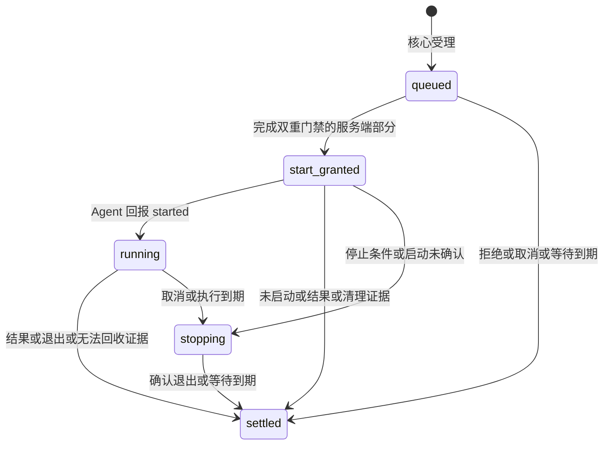
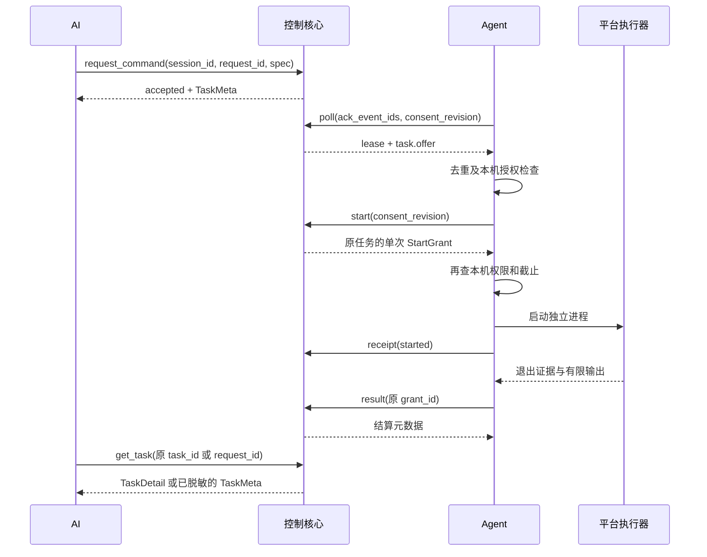

# Remota 任务状态与执行契约

任务是会话内的一次不可变执行意图。只有 MCP 命令工具能够创建任务；管理员不能提交命令。设备端先核验本机授权，再申请服务端开始许可，最后由本机执行器决定是否启动。通用认证、时限及错误见 [通用规则](README.md)，设备端点见 [设备通道](agent.md)。

Task、许可、结果和回执的消息结构见[Schema](schemas/messages.schema.json)；正常执行与六类异常的可观察条件见[验收规格](acceptance/README.md)。本页统一定义跨消息的任务行为。

## 共享任务模型

TaskSpec 的四个字段全部必填。MCP 在入口填充默认值后，核心保存完整不可变对象。下表为查阅摘要，边界以通用规则为准。

| 字段 | 类型与约束 |
|---|---|
| command | string；非空白、无 NUL，最多 4096 UTF-8 字节 |
| reason | string；非空白，最多 512 UTF-8 字节 |
| shell | auto、sh、powershell |
| timeout_seconds | integer；1 至 120 |

request_id 标识执行意图，属于 Task 本身，不属于 TaskSpec。TaskMeta 是下列对象；带问号的字段仅在条件满足时出现。

| 字段 | 类型与含义 |
|---|---|
| id、session_id、request_id | 对应任务、设备会话及客户端执行意图 |
| phase | queued、start_granted、running、stopping、settled |
| outcome? | succeeded、failed、rejected、cancelled、timed_out、unknown；仅 settled 必须出现 |
| consent_revision | 受理时的设备权限修订，正整数 |
| created_at、offer_deadline | 服务端时间；offer_deadline 不晚于会话截止 |
| execution_deadline? | 许可签发时确定，不可延长 |
| settled_at? | 首次进入 settled 的服务端时间 |
| initiator | {credential_id, mcp_client_id}，绑定首次发起身份 |
| execution | 下文的 ExecutionEvidence |
| stop? | {reason, requested_at, confirmation_deadline}，首个生效停止原因 |
| error_code? | 下文规定的执行错误标识 |
| details_available | boolean；当前是否允许查询 spec 与结果 |

TaskDetail 在 TaskMeta 上增加 spec，以及已获得时的 result={stdout, stderr}。退出码只在 execution 中出现，错误码只在 TaskMeta 中出现。任务列表和结束后的查询返回 TaskMeta，不返回命令正文、reason 或输出；管理员不提供任务详情。

设备 task.offer 包含不可变 TaskDetail 快照，只交付给仍有 full 的设备。Agent 将其 spec 与稍后的开始许可逐字段比较；有命令正文并不代表可以执行。活动会话中先前已经接收的结果可保留至会话结束，降权阻止新执行与新输出采集，不撤回已披露数据。

ExecutionEvidence 含 state，以及可选 start_observed_at、exit_observed_at、exit_code。它由任务阶段和已接受事实派生，不独立驱动状态转换。observed 时间为服务端接收回执的时间，不冒充实际 OS 时间；证据来自 Agent 自报。

| state | start_observed_at | exit_observed_at | exit_code |
|---|---|---|---|
| not_started、may_have_started | 禁止 | 禁止 | 禁止 |
| started | 必填 | 禁止 | 禁止 |
| exited | 可选 | 必填 | 可选 |
| unknown | 可选 | 禁止 | 禁止 |

完整结果可能先于 started 回执到达，因此 exited 不要求 start_observed_at。后来补到 started 时，其接收时间可以晚于 exit_observed_at；不能用这两个观察时间的大小推断实际启动、退出顺序。

- not_started：服务端从未签发许可，或 Agent 明确回报未创建命令进程。
- may_have_started：已发许可，尚未得到启动或未启动回执。
- started：Agent 已报告创建命令进程；尚无退出证据。
- exited：Agent 已报告任务进程退出并完成执行器要求的回收。
- unknown：曾可能启动，但停止确认等待届满或执行器无法确认回收。

执行证据的 not_started 不能由“没有收到 started”推导，exited 不能由“发出了取消”推导。exit_code 可以缺失，缺失不等于 0。

queued 派生为 not_started，start_granted 为 may_have_started，running 为 started；stopping 保留停止前的证据，settled 使用最终证据。业务结果和进程退出事实仍分别表示。

```json
{
  "id": "tsk_22222222222222222222222222222222",
  "session_id": "ses_11111111111111111111111111111111",
  "request_id": "33333333333333333333333333333333",
  "phase": "queued",
  "consent_revision": 1,
  "created_at": "2026-11-08T04:00:00.000Z",
  "offer_deadline": "2026-11-08T04:01:00.000Z",
  "initiator": {
    "credential_id": "crd_44444444444444444444444444444444",
    "mcp_client_id": "mcl_55555555555555555555555555555555"
  },
  "execution": {"state": "not_started"},
  "details_available": true
}
```

## 状态机



重复 offer 不改变 queued。完整结果可以先于 started 到达，直接结算；后来首次收到兼容的 started 只补接收观察，已接受过的相同 started 按重复回执处理。回执乱序按下表裁决。

| 已接受事实 → 后到消息 | 裁决 |
|---|---|
| not_started → started 或 exited；started/exited/完整结果 → not_started | RESULT_CONFLICT，不修改原事实 |
| 完整结果 → started | 可补 start_observed_at，保留结算与 exited 证据 |
| unknown → started | 可补 start_observed_at，execution 仍为 unknown |
| unknown → 兼容的 exited 或 not_started | 更新证据，保留原 outcome、settled_at，不接收输出；曾接受 started 时不得再接受 not_started |
| 已确认 exited → stop_unconfirmed | RESULT_CONFLICT，不把已知退出退回 unknown |
| 完整结果 → exited | 仅确认相同退出事实；若携带 exit_code，必须与原结果相同，原结果无退出码时也须省略 |

每种回执的首次正文必须缓存，重传不补字段或更换 reason。跨 kind 的兼容事实不等于重新执行或重新结算。

| 结算条件 | outcome | execution.state |
|---|---|---|
| 合法完整结果上报 succeeded，退出码为 0，且核心尚未接受停止条件 | succeeded | exited |
| 合法完整结果上报 failed，或明确未启动且 SPAWN_FAILED | failed | exited 或 not_started |
| 设备拒绝本机权限或不支持 shell，未启动 | rejected | not_started |
| 普通取消或授权失效，且确认退出或确认未启动 | cancelled | exited 或 not_started |
| 等待期限到期，尚未签发许可 | timed_out | not_started |
| 执行截止触发停止，且已确认退出或未启动 | timed_out | exited 或 not_started |
| 核心尚无停止原因，合法完整结果上报 cancelled 或 timed_out | 采用该 outcome | exited |
| 可能启动，但未得到停止证据 | unknown | unknown |
| 仅收到无输出退出回执，没有合法完整结果或停止原因 | unknown | exited |

settled 后不得重新进入执行阶段、重新发许可或更换 spec。outcome 为 unknown 的任务可以在保留期内补充与已接受事实兼容的 exited 或 not_started 证据，原 outcome 和 settled_at 保留，表示完整业务结果未能取得；不得补写迟到输出。其他终态的冲突结果返回 RESULT_CONFLICT。

not_started 回执在任务尚无停止原因时到达，以本机权限或 shell 拒绝结算 rejected，SPAWN_FAILED 结算 failed，其他放弃启动结算 cancelled；已经触发超时或停止时按既定原因结算。回执字段与 reason 枚举见 [ReceiptInput](agent.md#任务请求与回执)。

## 受理与幂等

幂等键为 (session_id, request_id)，保留至会话 [结束保留期](README.md#运行默认值)结束。比较完整 TaskSpec，忽略 JSON 成员顺序与转义形式；解码后的字符串、shell、timeout 必须相同，不修剪 command 或 reason。

提交应答丢失时，先按原 request_id 查询；查到后只查询或取消该任务。找不到且当前授权仍有效时，可用同 ID 和完整 spec 重试；查询失败保持未知，不换 ID“保证执行”或绕过失效授权。

- 同 ID、同 spec、同发起凭据，且当前请求仍有申请权限：返回原任务，reused=true，不创建事件、不延长期限。
- 同 ID、不同 spec：409 IDEMPOTENCY_CONFLICT。
- 同 ID、不同发起凭据：409 IDEMPOTENCY_CONFLICT，不转移任务所有权。
- 同一凭据建立新 MCP 客户端后，可以查询原 request_id；重复提交即使返回原记录，也不更换原 mcp_client_id，不恢复已取消的任务。
- 当前权限已收紧时，提交仍会失败；核对旧任务使用 get_task，不利用幂等缓存取得旧授权。
- 总计达到通用 [每会话任务上限](README.md#容量与数据限制)时拒绝新 ID，返回 TASK_LIMIT。已有 ID 的相同请求仍可核对，不淘汰旧记录。
- 现有任务尚未结算，或退出证据不明时，不接受新的命令意图，返回 TASK_BUSY。

受理、首次签发许可与重复 start 都必须重新检查：发起 MCP 凭据有效且 allow_exec、原 MCP 客户端有效、设备 access 凭据有效、设备 active 且未到期、本机 full 与权限修订仍匹配、管理存储健康。首次签发只允许 queued、未取消且无既往执行；重复 start 适用下节的阶段限制。在线观察本身不能代替这些条件。

## 开始许可

Agent 接受 offer 后，先把 task_id 记入本机已领取集合，再提交 start。一个任务只有一个 grant 和一次执行；重复事件不重新启动，去重记录保留到会话结束。

Agent 在该 task 的首次逻辑 start 发送前保存本机经过时间锚点，整个任务只使用这一锚点。Agent 不主动重试 start 取得执行权；服务端的重复处理用于应对同一请求的重复交付。应答丢失或超时后的放弃规则不变。

StartGrant 的全部字段如下。

| 字段 | 类型与含义 |
|---|---|
| id | grt ID |
| session_id、task_id | 原会话和任务 |
| consent_revision | 与本机当前修订及受理快照相同 |
| spec | 不可变完整 TaskSpec |
| issued_at、execute_before、execution_deadline | 服务端时间 |
| start_window_ms | 正整数；上限见通用 [开始许可窗口](README.md#时间与期限)，不超过剩余租约与执行期限 |
| execution_budget_ms | 正整数；不超过 timeout_seconds × 1000 |

execution_deadline 在许可签发时计算为 min(签发时刻 + timeout_seconds, 会话截止)。start_window_ms 进一步受当前服务端租约限制，execution_budget_ms 对应固定执行期限。许可响应不续租。

固定任务截止与当前租约是独立门禁。有效 poll 可更新租约，使命令在持续续租下运行至固定任务截止；租约不延长任务截止，首次租约也不永久截短该截止。运行中始终必须持有当前有效租约，具体失效处理见 [poll 与租约](agent.md#poll-与租约)。

Agent 核对原会话、task_id、consent_revision、完整 spec 和所有预算，按通用 [时间算法](README.md#时间与期限)计算本机许可窗口与固定任务截止。许可窗口再与当前租约、会话截止取最小值，任务截止与会话截止取最小值。缺失、不一致、请求取消或迟到响应均不得启动。

同一 grant 重复到达时沿用首次计算出的本机截止；若其他门禁收紧，只能进一步缩短。不得以重复请求或响应的时刻重算预算。例如首次发送在本机 t+4、start_window_ms=5000，则本机窗口到 t+9；t+8 收到相同 grant，仍到 t+9，不能改为 t+13。首次锚点缺失或已标记放弃时拒绝启动。

```json
{
  "id": "grt_88888888888888888888888888888888",
  "session_id": "ses_11111111111111111111111111111111",
  "task_id": "tsk_22222222222222222222222222222222",
  "consent_revision": 1,
  "spec": {
    "command": "printf 'ok\\n'",
    "reason": "核对命令通道",
    "shell": "sh",
    "timeout_seconds": 10
  },
  "issued_at": "2026-11-08T04:00:11.000Z",
  "execute_before": "2026-11-08T04:00:16.000Z",
  "execution_deadline": "2026-11-08T04:00:21.000Z",
  "start_window_ms": 5000,
  "execution_budget_ms": 10000
}
```

获得许可后、创建命令进程前，Agent 再次核验本机 full、修订、未取消、租约和时间窗口。执行器必须先建立所需的进程管理边界，再接收命令正文；Windows Job 分配失败时不得启动命令。创建进程后立即异步回报 started；回执不续期。

start 在同一核心边界按以下顺序处理：

1. 先校验当前身份、资源绑定和授权；ended 为 SESSION_ENDED，修订不匹配为 REVISION_CONFLICT。
2. 若已有 grant 且 now >= execute_before，返回 GRANT_EXPIRED；该检查优先于后续阶段检查，不改变既有停止或结算事实。
3. queued 且所有期限仍有效时首次签发；start_granted 且窗口仍有效时只返回原 grant 和当前 start_granted TaskDetail，许可各字段及期限不变。
4. running、stopping、settled 或其他不满足条件的状态为 INVALID_STATE，不返回许可。

因此成功 StartResponse 的 task.phase 只可能为 start_granted。重复请求不产生新许可，也不重新获得开始资格。

start 响应丢失或超时后，Agent 把该 task_id 标记为放弃启动，只回报 not_started；即使后来收到或查询到原许可也不执行。许可窗口到期仍无启动或未启动证据时，进入 stopping，reason=start_unconfirmed。

## 结果与输出

ResultInput 只用于命令已退出并完成回收的完整结果，必填 grant_id、consent_revision、outcome、stdout、stderr，可选 exit_code、error_code。outcome 为 succeeded、failed、cancelled、timed_out。未启动和无法确认回收分别使用 not_started、stop_unconfirmed 回执。

stdout 与 stderr 均为 Output，含 text、captured_bytes、truncated。按通用 [输出流上限](README.md#容量与数据限制)分别截取原始字节，之后继续排空并丢弃，替换无效 UTF-8 后生成 text。text 的 UTF-8 长度最多为该上限的 3 倍，captured_bytes 为 0 至该上限，truncated 为 boolean。不提供实时输出流。

```json
{
  "grant_id": "grt_88888888888888888888888888888888",
  "consent_revision": 1,
  "outcome": "succeeded",
  "exit_code": 0,
  "stdout": {"text": "ok\n", "captured_bytes": 3, "truncated": false},
  "stderr": {"text": "", "captured_bytes": 0, "truncated": false}
}
```

succeeded 必须 exit_code=0；failed 必须有非零退出码或 EXIT_CODE_UNAVAILABLE。退出码缺失必须携带该错误码，已有退出码则不得声称不可得。cancelled 和 timed_out 也必须确认回收，不能仅因“已发送 kill”上报。完整结果不接受 rejected 或 unknown。

TaskMeta.error_code 取自 not_started.reason，或为 EXIT_CODE_UNAVAILABLE、PROCESS_STOP_UNCONFIRMED。完整结果的 error_code 只接受 EXIT_CODE_UNAVAILABLE；停止不明走无输出回执，不能伪装成退出。原始 OS 错误不作为协议码。

完整结果首次接受要求 active、原权限修订仍为 full、access 与原发起 MCP 身份仍有效且任务未结算，grant_id 必须匹配原许可。身份失效、降权或会话结束时丢弃输出，只交无输出回执；不得换身份重传。

每任务只接受一份完整结果。相同正文重传返回既有 TaskMeta，不更新结算时间；不同正文为 RESULT_CONFLICT。重复确认仍检查当前身份，不能取得旧权限。没有收到提交应答时只重传原结果，不重新执行。

首次接收完整结果时，核心先应用已经到期的条件，再按下表确定 outcome；所有分支都以合法身份、原 full 修订和已确认回收为前提。

| 核心当前事实 | ResultInput.outcome | 最终 outcome |
|---|---|---|
| 已生效 stop.reason=execution_deadline | 任意合法值 | timed_out |
| 已生效的其他停止原因 | 任意合法值 | cancelled |
| 尚无停止原因 | cancelled 或 timed_out | 保留 Agent 上报值，即使 exit_code=0 |
| 尚无停止原因 | succeeded 或 failed | 保留上报值，退出码组合仍按 ResultInput 校验 |

Agent 的本机截止可能早于服务端截止；本机 poll 失败后的停止也可能先于核心观察。核心接受这些完整结果中的本机取消或超时事实，不根据退出码把它们改成成功或失败，不推测停止原因，也不事后伪造 stop.requested_at；此时 stop 省略。若核心停止原因已经生效，则仍以核心顺序为准。

已 settled 的结果不再走该表：相同完整结果只确认原结算；unknown 仅可补无输出证据，当前身份及会话仍有效时的迟到完整结果为 RESULT_CONFLICT。会话结束或收紧身份时，结果处理入口改按无输出回执，不绕过接收条件。

## 平台执行器约定

此约定限制可观察行为，不限定 Agent 实现语言。每条命令使用独立进程，以启动 Agent 用户的主目录为初始目录，始终以该用户执行；不保留前次目录、变量、交互输入或 PTY。

| 项目 | 约定 |
|---|---|
| shell | auto 在 Windows 选择系统 Windows PowerShell，在 Linux/macOS 选择 /bin/sh；显式 powershell 使用同一 Windows 引擎，sh 使用 /bin/sh。缺失或不支持时 not_started/UNSUPPORTED_SHELL |
| 入口与配置 | shell 使用已确定的系统绝对路径；不从当前目录或不可信同名程序解析。PowerShell 不加载 profile，使用非交互模式，遵守系统执行策略 |
| command 与 stdin | 原 Unicode 正文作为一次脚本执行，不隐式修剪或改写换行；命令 stdin 从启动起为 EOF，不向命令提供终端或 Agent 的本机输入 |
| 编码 | 配置 shell 的标准文本输出为 UTF-8；外部程序仍可能产生无效字节，按 Output 的替换与截断规则处理，不按系统区域设置猜测编码 |
| 退出码 | 使用命令 shell 进程的 OS 退出码，不解析输出或推导最后一个子命令状态；缺失退出码按 EXIT_CODE_UNAVAILABLE |
| Windows 环境白名单 | SystemRoot、WINDIR、ComSpec、TEMP、TMP、USERPROFILE、HOMEDRIVE、HOMEPATH、PATH、PATHEXT，仅复制存在且执行所需的值 |
| Linux/macOS 环境白名单 | HOME、USER、LOGNAME、PATH、TMPDIR、LANG、LC_ALL、LC_CTYPE、TZ，仅复制存在且执行所需的值 |
| 身份与句柄 | 不继承 Remota 凭据、其他环境变量、监听/连接句柄或管理句柄；只开放执行与管道所需的资源 |

命令进程创建前必须建立管理边界。Windows Job 必须启用 JOB_OBJECT_LIMIT_KILL_ON_JOB_CLOSE，Job 句柄由执行器持有且不继承，不启用 breakaway；无法建立或加入要求的边界时不启动命令。Linux/macOS 使用独立进程组管理可跟踪进程。spawn 指创建承载 TaskSpec 的命令进程；准备边界的受托执行器不计入。一旦命令进程已创建，即使正文尚未运行，也不能再报告 not_started。

收到停止条件后立即禁止新执行并请求回收整个管理边界，必要时走平台强制终止路径；观察复用任务停止确认预算，不新增清理窗口。剩余预算不可证明时立即采取强制停止路径。只有命令进程已回收、边界内被管理进程及输出管道均完成回收，才报告 exited 或完整结果；主 shell 退出而后台进程或管道仍存活不算完成，无法确认则 stop_unconfirmed。

Agent 正常退出必须先停止任务。崩溃或被强杀可能使 Agent 无法发送任何证据：Windows 的最后 Job 句柄关闭会触发其所含进程终止；Linux/macOS 的进程组本身不提供父进程消失后的自动回收保证。各平台均不能把 Agent 消失视为退出确认，服务端仍按租约和停止确认收敛为 unknown，新的 Agent 不接管或重放旧任务。

该回收边界不承诺约束主动逃逸边界的任意命令。平台行为参考 [Windows Job](https://learn.microsoft.com/en-us/windows/win32/procthread/job-objects)、[Job 关闭限制](https://learn.microsoft.com/en-us/windows/win32/api/winnt/ns-winnt-jobobject_basic_limit_information)及 [POSIX/Linux 进程退出](https://man7.org/linux/man-pages/man2/_exit.2.html)。

## 取消与竞态

stop.reason 为 operator_cancel、local_revoked、credential_invalid、mcp_client_ended、session_ended、execution_deadline、transport_lost、server_degraded、start_unconfirmed 之一。首个由核心接受的停止原因固定，重复取消不重置确认期限。处理请求时先应用已到期条件，再处理取消。

同轮多个截止的排序只在[公共截止裁决](README.md#多个截止的裁决顺序)定义。会话/租约截止与执行截止相同时，先结束会话并固定 session_ended；确认退出后为 cancelled，不接收结束后的完整输出。仅执行截止到期且原授权仍有效时才由 execution_deadline 裁决 timed_out。

- 未签发许可时，取消可直接 settled/cancelled/not_started。
- 已签发许可后，立即使许可失效并进入 stopping；没有 started 也不能断言未执行。
- 事件 ack 仅确认收到指令，phase 保持 stopping。
- 收到 exited 或 not_started 后，按既定停止原因结算为 cancelled 或 timed_out。
- [停止确认等待](README.md#运行默认值)届满仍无退出证据，结算 unknown，并结束旧设备会话；清理指令继续保留。
- 退出已被核心接受为成功或失败后到达的取消，不修改该结果。
- 停止先被核心接受，随后收到 exit_code=0，仍按取消或超时结算，同时保留退出码证据。

本机收紧与停止入口按 [设备授权](agent.md#降权和结束)和 [租约规则](agent.md#poll-与租约)执行。取消不回滚副作用，进程组与 Job 用于回收进程，不提供任意命令沙箱。

无停止原因的 exited 清理回执只确认进程已退出，业务结果为 unknown；既然退出已确认，不因此结束仍有效的设备会话。迟到 started 可以补记 start_observed_at，但不能把 settled 任务恢复为 running，也不能把 unknown 退出状态改成确定存活。

stop_unconfirmed 立即结算 unknown/unknown 并结束旧会话，无需等待剩余确认窗口。核心已接受的停止原因优先于 ResultInput 中的 outcome，返回的 TaskMeta 反映核心顺序；Agent 不能用随后上报 succeeded 覆盖已经生效的取消。

## 完整执行顺序



服务端授权与设备 OS 启动之间没有跨机原子事务。开始许可、再次本机检查和有限租约共同限制竞态；远端撤权的响应只能确认核心拒绝新操作，不能声称同一瞬间设备进程已经退出。
